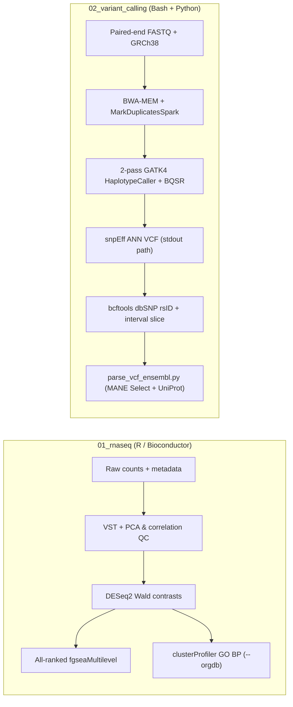

# Bulk RNA-seq & Human Variant Calling Pipelines

[](https://github.com/yijiulu/omics-rnaseq-variants/actions/workflows/ci.yml)
[](LICENSE)

Modular, reproducible bioinformatics workflows written in **R**, **Bash**, and **Python** for bulk transcriptomics (`DESeq2` / `fgsea` / `clusterProfiler`) and targeted human Illumina variant calling (`BWA-MEM` / `GATK 4` / `snpEff` / Ensembl REST API).

> **Data note**: Raw sequencing files (FASTQ/BAM/VCF) and count matrices are excluded from this repository. All scripts accept portable command-line inputs and environment overrides.

## Workflow Architecture



## Modules

| Directory | Domain | Stack | Key Stages |
| :--- | :--- | :--- | :--- |
| [`01_rnaseq/`](01_rnaseq/) | Bulk RNA-seq differential expression & pathway analysis | R (`DESeq2`, `fgsea`, `clusterProfiler`, `ggplot2`, `gplots`, `VennDiagram`) | VST normalisation, PCA & sample-correlation outlier QC, `DESeq2` Wald contrasts, volcano plots, all-ranked Wald-statistic `fgseaMultilevel`, species-configurable (`--orgdb`) GO BP enrichment + redundancy simplification, clustered heatmaps, multi-contrast Venn overlaps |
| [`02_variant_calling/`](02_variant_calling/) | Targeted human Illumina variant calling & transcript annotation | Bash (`BWA-MEM`, `GATK 4`, `samtools`, `snpEff`, `bcftools`) + Python (`Ensembl REST API`) | Pipe-composable alignment, `MarkDuplicatesSpark`, 2-pass `HaplotypeCaller` with hard-filtering + BQSR, `snpEff` & dbSNP `rsID` annotation, structured `ANN=` VCF parsing, and Ensembl MANE Select / UniProt-SwissProt cross-referencing |

## Repository Structure

```text
.
├── .github/workflows/ci.yml
├── 01_rnaseq/
│   ├── README.md
│   ├── scripts/
│   │   └── run_deseq2_pathway_pipeline.R
│   └── tests/
│       └── test_rnaseq_cli.R
├── 02_variant_calling/
│   ├── README.md
│   ├── scripts/
│   │   ├── run_variant_pipeline.sh
│   │   ├── annotate_against_known.sh
│   │   └── parse_vcf_ensembl.py
│   └── tests/
│       └── test_parse_vcf.py
├── environment.yml
├── LICENSE
└── README.md
```

## Installation

Create the combined R/Bioconductor and NGS CLI environment with `mamba` or `conda`:

```bash
mamba env create -f environment.yml
mamba activate omics-pipelines
```

## Quick Start

### Bulk RNA-seq Pipeline

Supports both human (`--orgdb org.Hs.eg.db`) and mouse (`--orgdb org.Mm.eg.db`, default) gene-symbol annotation packages:

```bash
Rscript 01_rnaseq/scripts/run_deseq2_pathway_pipeline.R \
  --counts path/to/counts.csv \
  --metadata path/to/metadata.csv \
  --target TREATED \
  --reference CONTROL \
  --orgdb org.Hs.eg.db \
  --outliers "SAMPLE_OUTLIER_1" \
  --pathways path/to/msigdb_hallmark.gmt \
  --outdir outputs/rnaseq
```

### Variant Calling & Ensembl Annotation Pipeline

The two Bash stages isolate operational logs to `stderr` and emit only the resulting VCF path on `stdout`, enabling direct Unix pipe composition:

```bash
SNPEFF_JAR=/path/to/snpEff.jar \
  bash 02_variant_calling/scripts/run_variant_pipeline.sh brca1 17 \
    reads_R1.fastq.gz reads_R2.fastq.gz Homo_sapiens.GRCh38.dna.chromosome.17.fa | \
  bash 02_variant_calling/scripts/annotate_against_known.sh /path/to/dbsnp_chr17.vcf.gz 43044295 43170245

python3 02_variant_calling/scripts/parse_vcf_ensembl.py \
  --vcf brca1_filtered_snps_final_ann_dbsnp.vcf \
  --start 43044295 \
  --end 43170245 \
  --outdir outputs/variants \
  --gene BRCA1 \
  --query-ensembl
```

## Verification

Run unit tests and syntax checks across all modules:

```bash
Rscript 01_rnaseq/tests/test_rnaseq_cli.R
python3 -m unittest discover -s 02_variant_calling/tests -v
bash -n 02_variant_calling/scripts/run_variant_pipeline.sh
bash -n 02_variant_calling/scripts/annotate_against_known.sh
```

## Licence

Released under the [MIT License](LICENSE).
